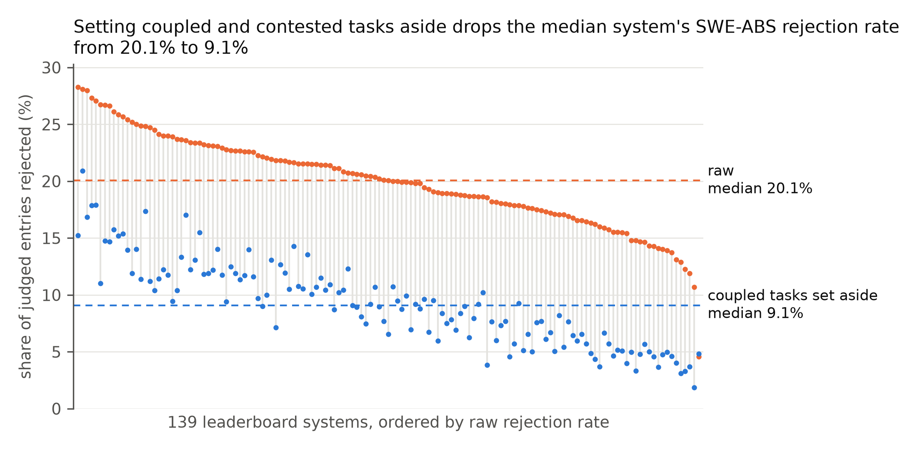

# Gold-Coupled Tests: Auditing Reference Overfitting in SWE-bench Hardening (data and reproduction)

Repository: https://github.com/ph-phuc/swe-bench-gold-coupling · Kaggle dataset: `phucphan1406/swe-bench-gold-coupling-census` (SWE-bench gold-coupling census)


[](https://www.kaggle.com/competitions/gemma-4-developer-agent-paper)
[](https://www.kaggle.com/datasets/phucphan1406/swe-bench-gold-coupling-census)
[](https://www.kaggle.com/code/phucphan1406/swe-bench-gold-coupling-reproduce)


Data, code and prompts behind the writeup *"Gold-Coupled Tests: Auditing Reference Overfitting in SWE-bench Hardening"* (an issue-grounded census of SWE-ABS rejections on SWE-bench Verified, with Gemma 4 auditor baselines). Every headline number of the writeup is recomputed
from the files here, on a CPU, in seconds; a few secondary numbers are not, and are [listed below](#not-reproduced).
Nothing in this release calls a model or re-runs Docker: the model verdicts and the test labels are shipped as data,
and each verdict can be checked against its issue quote and test name.

## TL;DR

The track asks: *"What if every developer could rely on an autonomous agent equally capable offline, on consumer
hardware?"* Such agents, and the RL rewards and verifiers that train them, need tests that mean what they say. This
release is the reference: a census of what a hardened suite rejects, labelled by a costly cloud protocol and checked
by five blind annotators, plus measurements of Gemma 4 as an offline test auditor against it.

We re-ran **39,133** resolved SWE-bench Verified leaderboard entries (151 systems) on the original tests and on the
SWE-ABS hardened suite. SWE-ABS rejects **19.5%** of the entries that pass the original tests, in 305 tasks. For each
of those tasks, a model reader took the **most-failed hardened test** (one test per task) and, after reading the issue,
hints, gold patch and a few rejected patches, asked: *does the issue, with its hints, ask for what this test checks?* (standard: `briefs/handread.md`). A task counts as **coupled** to the gold patch only
when a second, adversarial reader (the refuter, same model) agrees.

- **108 of 305** tasks are coupled; they hold **57.6%** of the rejected entries. Of these, 105 tasks (52.8%) have a
  test that pins a gold artefact; 3 tasks (4.8%) have a test that checks where gold improved on the issue's own
  proposed fix. Two of those three were in the human spot check, and the annotators' majority called both genuine
  (not independent evidence: the split's brief used these two tasks as its examples).
- **173** tasks are genuine rejections, holding 31.5%: SWE-ABS catches real errors. 23 tasks (10.9%) are contested
  (the refuter disagreed) and 1 is an environment failure.
- Setting coupled tasks aside lowers the pooled rejection rate from **19.5% to 8.7-10.8%** (9.9-11.8% if the three
  kind-2 tasks count as genuine). This is a range under a per-task rule, not a count of wrongly rejected patches.
- **Human check:** five blind annotators on 10 tasks agree with the model readers about as well as with each other
  (mean Cohen kappa 0.44; Fleiss 0.36 among the humans; one annotator, an author, saw a shorter packet).
- **Can an open-weights model run this audit locally?** The census labels come from a large closed model, which is
  slow and costly to run on every new hardened suite. We ask Gemma 4 the same question on 76 two-reader-labelled
  tasks (table below): the 12B is a precision-first flagger, right on 21 of its 28 flags (base rate 0.58), but it
  misses about half of the coupled tasks.

| Gemma 4 | Cohen's kappa [95% CI] | flags | precision | recall |
|---|---|---|---|---|
| E4B (fp16) | 0.127 [-0.090, 0.327] | 42% of tasks | 0.66 | 0.48 |
| 12B (fp16) | 0.242 [0.043, 0.446] | 28 (37%) | 0.75 (21/28) | 0.48 |
| 31B (nf4, exploratory) | 0.117 [0.039, 0.226] | 6 (8%) | 1.00 (6/6; Wilson 0.61-1.00) | 0.14 |
- **Checkable:** `reproduce.py` recomputes 150 numbers of the writeup and asserts each one; the table
  [below](#where-each-headline-number-comes-from) maps every number to its script and file.



*Figure 1. 139 leaderboard systems with at least 100 judged entries. Median rejection rate 20.1% raw, 9.1% with coupled
and contested tasks set aside (the in-scope rate; see Glossary). Drawn by `figures/fig1_rates.py` from
`data/system_rates/per_system_corrected.csv`.*

The verdicts are model judgements, per task: read [Limits](DATASHEET.md#limits) before reusing them. SWE-ABS's own
authors inspected their tests, found 53 of 500 instances whose tests encode gold-specific behaviour, and corrected them
before release; this census audits the corrected release against one written standard. Our 19.5% is close to the
19.78% SWE-ABS reports on a different population of patches.

## Quickstart: load the data

```python
import pandas as pd   # pip install pandas
e = pd.read_csv("data/labels/entries.csv")                       # 39,133 entries, one per system x task
judged = e[(e.label_official == 1) & e.label_hardened.notna()]  # 36,620 judged by SWE-ABS
wbp = judged[judged.label_hardened == 0]                         # 7,157 rejected: 19.5%
t = pd.read_csv("data/task_verdicts.csv")                        # 305 tasks, one verdict each
print(wbp.merge(t, on="instance_id")["class"].value_counts(normalize=True).round(3))
# coupled 0.576, in_scope 0.315, contested 0.109, env 0.000
```

`t[t["class"] == "coupled"]` lists the coupled tasks with the issue quote (`issue_quote`), the test (`top_test`), what
the test requires (`test_requires`), what agents did (`agents_do`), and both readers' reasons (`why`, `refuter_reason`).
Corrected per-system rates with 95% intervals are in `data/system_rates/per_system_corrected.csv`.

## Glossary

| Term | Meaning |
|---|---|
| entry | One leaderboard system's submission for one task. |
| hints | The comments on the GitHub issue, shipped with each SWE-bench task (`hints_text`). |
| gold patch | The reference fix of a SWE-bench task: the patch from the pull request that closed the issue. |
| judged | The entry passes our re-run of the original tests and SWE-ABS gives a complete verdict. |
| wrong-but-passing (wbp), "rejected" | A judged entry that fails SWE-ABS. "Wrong" is SWE-ABS's verdict, not our judgement of the patch. |
| near-total task | A task where at least 90% of judged entries are wbp (35 tasks). |
| `interface` | First-reader category: the test needs a name, keyword or signature that only gold adds. |
| `gold_choice` | First-reader category: the test asserts a choice the issue leaves open or contradicts. |
| `in_scope` = genuine = G | The test checks what the issue asks for or clearly implies: a genuine rejection. `in_scope` in the census, `genuine` in the auditor benchmark, G in the spot check (C there is coupled). |
| `in_scope_kind` | For `in_scope` tasks of later rounds: `miss` (the patch misses what the issue asks) or `regression`. |
| `env` | An environment failure. |
| coupled | Both the first reader and the refuter say `interface` or `gold_choice`. |
| contested | The refuter disagrees with a coupled first verdict. Contested tasks count as neither coupled nor in scope: they are left out of the in-scope rate and kept in the excl-coupled rate. |
| kind 1 / kind 2 | Coupled tasks split: the test pins a gold artefact (1), or checks a gold improvement over the issue's own proposed fix (2). |
| in-scope rate | Rejection rate over in-scope tasks and tasks with no wbp only (coupled and contested tasks left out): the low end of 8.7-10.8%. |
| excl-coupled rate | Rejection rate over every task except coupled ones (contested and env kept): the high end of 8.7-10.8%. |
| first round | The 85 tasks read on 26 October 2026 (the 35 near-total tasks and a 50-task random sample); the auditor benchmark is built from them. |
| UTBoost | A second hardened suite for SWE-bench; its labels (`label_utboost`) are shipped for comparison (159 rejections in 16 tasks). |

## Reproduce every headline number (one command, CPU, seconds)

```
pip install -r requirements.txt      # numpy, pytest (matplotlib only to redraw Figure 1; pandas only for the quickstart)
python reproduce.py                  # recomputes 150 numbers and asserts each against draft_numbers.json
python -m pytest -q code             # 24 tests of the tally, rate, evaluator and helper code
```

`reproduce.py` ends with `ALL 150 CHECKS PASS`. It runs in about 5 seconds on a laptop CPU. One line per number
names the writeup section it comes from. If a check fails, the script exits 1. Bootstrap intervals are byte-equal with
numpy 2.5.2 (`default_rng(0)`); another numpy version may move an interval bound in the last digit, and `reproduce.py`
then reports the difference.

`draft_numbers.json` holds each number as the writeup prints it. Integers must match exactly; decimals must match to
the printed precision. An entry may carry a `correct` field when the writeup prints a number wrongly: the check then
uses the value from the data and lists the entry as `DRAFT-FIX` until the writeup is corrected. No entry carries one
at present.

## Where each headline number comes from

| Writeup | Number(s) | Computed by | From |
|---|---|---|---|
| Abstract, 1, 2 | 39,133 entries, 151 systems, 470 tasks, 31,654 unique patches; 36,620 judged, 7,157 wrong-but-passing (19.5%), 6,445 unique, in 305 tasks; UTBoost 159 in 16 tasks; 447 / 23 tasks with all / not all suites valid; 35 near-total tasks holding 2,188 | `reproduce.py` step 1 (`label_table`) | `data/labels/entries.csv`, validity columns of `data/census/per_task.csv` |
| Abstract, 3, Table 1, 11 | 305 read; 131 coupled first verdicts sent to the refuter, 108 upheld, 23 contested; 108 / 173 / 23 / 1 tasks; 4,121 / 2,253 / 782 / 1 entries; 57.6 / 31.5 / 10.9 / 0.0%; unique 3,656 / 2,084 / 704 / 1; 28 of 35 near-total coupled (1,860 of 2,188, 85%); other 270 tasks 45.5% (2,261 of 4,969); 13 `interface` and 118 `gold_choice` first verdicts | `python code/audit_tally.py --require-census` (step 2) | `data/census/` |
| Abstract, 4, Table 2 | 108 coupled tasks split into kind 1 (gold artefact) 105 tasks / 3,776 entries / 52.8% and kind 2 (gold improvement) 3 / 345 / 4.8%; 91.6% of coupled entries are kind 1; 8 kind 1 by rule; refuter on 3 of 3 kind-2 calls and 19 of 97 sampled kind-1 calls (19 upheld, Wilson 0.83-1.00), 22 of 108 tasks re-read; sensitivity: 17 medium-confidence calls, 44.4% / 13.1% | `python code/split_tally.py` (step 2b; equal to `data/census/split_tally.json`) | `data/census/split_*.jsonl` |
| Abstract, 5, Table 3 | pooled 19.5% / 8.7% / 10.8%; tasks 470 / 338 / 362; judged 25,831 / 28,176; wbp 2,253 / 3,036; 139 ranked systems; median 20.1% to 9.1%, IQRs; ratio 0.17-1.05 (IQR 0.35-0.52); median coupled share 57.1%; Spearman 0.92; median rank-interval width 64; 165 tasks without wbp; 2,000 draws; with the 3 kind-2 tasks counted as genuine: 9.9-11.8%, median system 10.3%; Figure 1: 139 systems, medians 20.1% and 9.1% | `python code/system_rates.py --out out/rates` and `... --kind2-genuine` (step 3; both equal byte for byte to `data/system_rates/`); `python figures/fig1_rates.py` redraws the figure | `data/census/`, `data/labels/entries.csv` |
| Abstract, 6 | five blind annotators: model vs each annotator mean Cohen 0.44, Fleiss 0.36 among the humans (mean pairwise Cohen 0.386); majority of five agrees with the model on 7 of 10; majority G on both kind-2 tasks (13410 4-1, 16527 3-2) and C on 5 of 6 kind-1 tasks (11292 3-2 for G); both controls G for all five; the strictest annotator says G on 8 of 10 | `python code/spotcheck_agreement.py` (step 4; equal to `data/spotcheck/spotcheck_agreement.json`) | `data/spotcheck/spotcheck_letters.json`, `data/census/split_tally.json` |
| Abstract, 7, Table 4 | 85 tasks, 76 decided, 58% coupled; kappa, CI, share called coupled, precision, recall for E4B, 12B and 31B-nf4; 21 of 28 12B flags right; 31B 6 flags, all right | `python code/eval_audit.py data/auditor_benchmark/predictions/a1-r1-e4b-12b.jsonl data/auditor_benchmark/labels.jsonl --config data/auditor_benchmark/configs/audit.json` (and `a1-31b-nf4.jsonl` with `audit31.json`); step 5 | `data/auditor_benchmark/` |
| 3, 9 (carried) | rule AUROC 0.54 on 76 tasks; parser misses: 15 runs in 2 tasks | read, **not recomputed** (step 6) | `data/carried/` |

### Not reproduced from this release
- the AUROC of the name-based rule, which needs issue and gold-patch text;
- the parser-miss scan and its "up to 126 Django runs" bound, which need the harness run logs;
- the LoRA training null result in Section 9;
- the numbers quoted from other papers (SWE-ABS 19.78% and 53/500, PatchDiff, OpenAI, TestJack).

## Files

| Path | What it is |
|---|---|
| `data/labels/entries.csv` | One row per resolved leaderboard entry (39,133). Columns: `system`, `instance_id`, `sha` (sha256 of the patch text), and our re-run labels on the original suite, SWE-ABS and UTBoost (`label_official`, `label_hardened`, `label_utboost`: `1` pass, `0` fail, empty = no valid verdict). No patch text is included. |
| `data/labels/summary.json`, `per_repo.csv`, `invalid_controls.json` | Label-table totals, per-repository counts, and the tasks whose gold or no-op control failed a suite. |
| `data/task_verdicts.csv` | Convenience view, one row per task with wbp (305). Columns: `instance_id`; `read_set` (reading round: `near_total`, `sample15`, `sample35`, `rest`); `class` (`coupled`, `contested`, `in_scope`, `env`); `kind` (1 or 2 for coupled tasks, empty otherwise); the first reader's `first_category`, `confidence`, `top_test`, `issue_quote`, `test_requires`, `agents_do`, `why`, `in_scope_kind`; the refuter's `refuter_verdict` and `refuter_reason` (empty when not refuted); and the task's counts `abs_wbp` (wbp entries), `abs_judged` (judged entries), `unique_abs_wbp` (unique wbp patches). Rebuild with `python code/task_verdicts.py`. |
| `data/census/handread_*.jsonl` | First-reader verdict records, one per task with wbp (305 in total). Fields: `category` (`interface` / `gold_choice` / `in_scope` / `env`), `confidence`, `top_test`, `issue_quote` (a short quote; the brief asked for 25 words at most, and three records run to 26-29), `test_requires`, `agents_do`, `why`, and `in_scope_kind` (census rows). |
| `data/census/refute_*.jsonl` | Refuter verdicts on the 131 coupled first verdicts: `your_verdict`, `agree`, `reason`. |
| `data/census/per_task.csv`, `per_system.csv` | Per-task and per-system counts that the tally and rate code join on. |
| `data/census/audit_tally_census_2026-10-29.json` | Saved tally output. `reproduce.py` asserts that a fresh tally equals it. |
| `data/census/split_kind.jsonl`, `split_refute.jsonl`, `split_tally.json` | The split of the 108 coupled tasks: one record per task (`kind` 1 or 2, `reader` model or rule, `confidence`, `evidence`, `proposal_in_issue`, `agents_follow_proposal`, `why`), the refuter's re-reads (`first_kind`, `your_kind`, `agree`, `reason`), and the saved tally. |
| `data/system_rates/` | Corrected per-system rates for 151 systems, with task-bootstrap 95% intervals and rank changes, plus the summary; `*_kind2genuine*` is the same with the 3 kind-2 tasks counted as genuine. |
| `figures/` | Figure 1 (PNG and SVG) and the script that draws it from `data/system_rates/per_system_corrected.csv`. |
| `figures/cover.png` | The writeup's cover image (1200 x 630): the 52.8% kind-1 share and the median system's rate, 20.1% raw and 9.1% with coupled and contested tasks set aside. |
| `notebooks/reproduce_and_audit.ipynb` | Kaggle notebook. Part 1 (CPU, no internet) runs `reproduce.py`, loads the data with pandas and redraws Figure 1. Part 2 (optional, off by default, two T4 GPUs and internet) asks Gemma 4 E4B the audit question on 2 benchmark tasks with `code/audit_prompt.py`, building each prompt at run time from public sources; the run logs' error lines are not public, so that one prompt section is empty. |
| `data/spotcheck/spotcheck_letters.json`, `spotcheck_agreement.json` | The blind human spot check: 10 tasks, the model letters, and the letters of five annotators (C coupled, G genuine): a1 an author, short packet without hints; a2-a5 external annotators, full packet. The agreement file holds per-annotator agreement, Cohen and Fleiss kappas and the majority vote. The packets are not included: they quote issue and patch text. |
| `data/auditor_benchmark/labels.jsonl` | The test-auditor benchmark: the 85 first-round tasks with the two-reader reference (`coupled` / `genuine` / `contested`). 76 are decided. |
| `data/auditor_benchmark/packet_index.jsonl` | For each benchmark task: the failing SWE-ABS tests with run counts, and the agent patches shown to the model (sha256 and the systems that submitted them), and `text_sha256`: the sha256 of the issue, hints, gold patch and SWE-ABS test patch (first 6,000 characters) as the prompt used them. Texts are not included; see Licence. |
| `data/auditor_benchmark/predictions/` | Gemma 4's saved outputs (raw text, parsed verdict, token counts) for E4B and 12B (fp16) and for 31B (nf4, exploratory). One seed, greedy decoding. |
| `data/auditor_benchmark/configs/` | Model IDs and Hugging Face revisions of the Gemma runs. |
| `data/carried/` | Two result files whose numbers are read, not recomputed (see above). |
| `code/audit_tally.py` | Combines the first-reader and refuter verdicts into task classes and counts. With `--require-census`, it exits 1 unless every task with wbp is read and every coupled first verdict is refuted. |
| `code/system_rates.py` | Corrected per-system rates and the task bootstrap. It exits 1 unless its counts reconcile with `per_task.csv`, `per_system.csv` and the census. |
| `code/eval_audit.py`, `code/audit_prompt.py` | The frozen evaluator of the Gemma auditor (kappa, bootstrap CI, precision and recall), and the exact prompt and verdict parser. |
| `code/split_tally.py` | Tally of the kind split; checks that every kind-2 call and the seeded 20% kind-1 sample have a refuter row. |
| `code/spotcheck_agreement.py` | Spot-check agreement (per annotator, Fleiss, pairwise Cohen, majority). |
| `code/wilson.py`, `code/task_verdicts.py` | Wilson interval; the verdict view. |
| `code/fetch_patches.py` | Fetches the leaderboard patches from their public source (SWE-bench/experiments) and hashes them, so they can be joined to `entries.csv` by `sha`. Its outputs (`data/raw/`, `data/passing_patches/`, `data/passing_index.jsonl`, `data/index_report.json`) are git-ignored: do not commit them. |
| `code/test_release.py` | Tests. |
| `briefs/handread.md`, `briefs/refute.md`, `briefs/split_kind.md` | The reader, refuter and split prompts, verbatim except that the local path is removed. The paths inside them name files of the working copy: `results/w1_label_table/` is `data/census/` here, and `data/w1/work/label_long.csv` is `data/labels/entries.csv`. Comments in the code cite working-copy documents that are not part of this release. |
| `DATASHEET.md` | Motivation, composition, collection (models, dates, effort, the combination rule), uses, limits, distribution and maintenance. |
| `CHANGELOG.md`, `CITATION.cff`, `dataset-metadata.json` | Version history; citation metadata; the Kaggle dataset metadata. |

## How the verdicts were made

In short: a frontier cloud API model, run as two fresh-context readers of the same model, made every verdict. The
first reader classified the most-failed SWE-ABS test of each task against the issue; a second fresh reader, told to argue for "genuine", refuted every coupled verdict; the combination rule was fixed
before any refuter result was read. The model's checkpoint, dates, effort, what was not recorded, the kind split, the human spot check
and the Gemma 4 runs are in [DATASHEET.md, section 3](DATASHEET.md#3-collection-process). The prompts are in `briefs/`.

## Report a label you think is wrong

Every verdict is a model judgement and some will be wrong. To report one, open an issue on the GitHub repository
(its URL is in `CITATION.cff`; on Kaggle, the dataset's discussion tab works too) with the **Wrong label** template, or a
plain issue, and give:

1. the `instance_id` and the file and field (for example `data/census/handread_rest.jsonl`, `category`);
2. the label you think is right;
3. your evidence: the part of the issue or hints, and the test, you base it on.

A confirmed correction is released as a new version, with the numbers recomputed by `reproduce.py` and the change
listed in `CHANGELOG.md` (see [Maintenance](DATASHEET.md#7-maintenance)).

## Contact

Questions and corrections go to the repository's issue tracker (see above).

## Licence

- **Our code** (`code/`, `reproduce.py`): MIT, see `LICENSE`.
- **Our annotations and derived data** (`data/`, `briefs/`, `draft_numbers.json`): CC BY 4.0, see `LICENSE-DATA`.
- **Third-party material** is quoted only in short excerpts, under its own terms; see `NOTICE`. That covers issue
  quotes, test names and short test descriptions in the verdict records, and Gemma output text that quotes tests.
- Agent patches, full issue texts, gold patches and SWE-ABS test files are **not** redistributed. Fetch them from
  SWE-bench Verified, SWE-ABS and SWE-bench/experiments (`code/fetch_patches.py`).

## Citation

Author: Phuc Phan. Repository URL, title, version and date: see `CITATION.cff` (GitHub shows it as "Cite
this repository"); the repository and dataset links are also at the top of this file and in DATASHEET.md §6.

Please also cite SWE-bench, SWE-ABS (arXiv:2603.00520) and UTBoost (arXiv:2506.09289).
